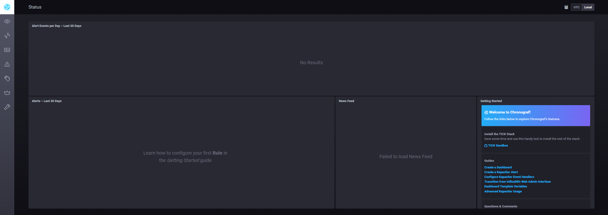
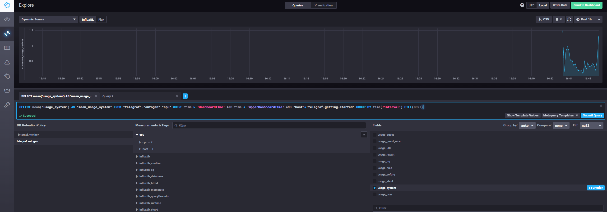
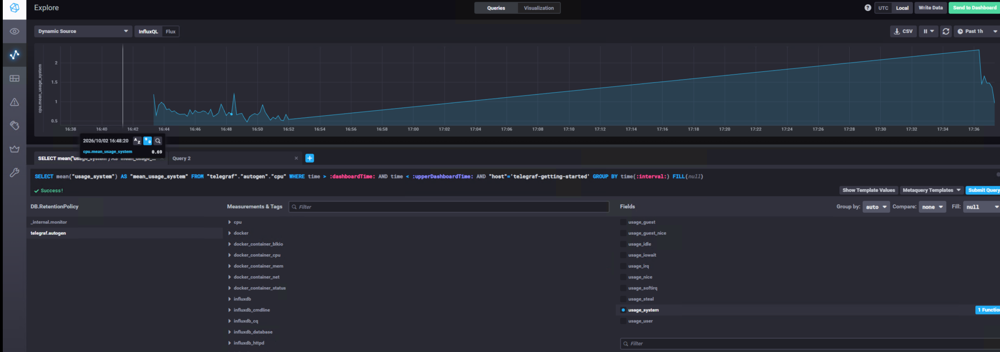

# Домашнее задание к занятию "13.Системы мониторинга"

## Обязательные задания

### 1. 

Для данной системы я бы ввёл следующие основные метрики:

1. CPU usage/Load Average - т.к. вычисления сильно могут нагружать центральный процессор. 
По ним можем определять, хватает ли CPU (кол-во ядер) системе и нет ли постоянных нагрузок.

2. RAM и SWAP - чтобы контроллировать оперативную память, чтобы не ходил киллер и мы могли вовремя заметить 
нехватку оперативной памяти.

3. df -h и df -i - обязательно следим за памятью и кол-ву айнодов. Т.к. если что-то из этого забито приложение
не сможет сохранять отчёты. В нашем случае может закончится кол-во айнодов (если файлов много) которые могут
раньше места на диске закончиться.

4. HTTP время ответа - чтобы понять, какая задержка, и на каком этапе чтобы устранить именно точечно проблемы.
Также полезно знать время ответа пользователям.

5. HTTP код ответа - смотреть кол-во успешных запросов в виде кода.

### 2.

Для менеджера не обязательно знать и понимать что такое RAM, CPU, SWAP... 
Поэтому для менеджеров можем предложить следущие модели:

SLO - Целевой уровень качества обслуживания. 99% запросов должны быть успешные, 95% быстрее 1 секунды.

SLI - Соглашение об уровне обслуживания. Пример:
        % Успешных HTTP запросов.
        Время ответа.
        Доступность сервера.
        Кол-во ошибок.

SLA - Индикатор качества обслуживания. Договариваемся с клиентом о гарантированном уровне
обслуживания. Насколько хорошо работает сервис и возможные последствия если этот 
уровень не соблюдается.

Таким образом, менеджер не смотрит на CPU RAM и т.п. вещи, а видит только то, насколько хорошо сервис работает
для клиентов и выполняет заявленные обязательства.

### 3. 

Если же бюджета у компании на полноценную систему сбора логов нет, можно организовать к примеру простого самописного агента.
Будет служить для логирования или отправки ошибок.

Он будет записывать логи приложения и отправлять их на центральный мониторинговый сервер по HTTP.
Таким образом можно организовать упрощённый централизированный сбор логов.

Приложение → log-файл → агент → HTTP → сервер сбора

По подобному принципу уже работают такие готовые агенты как Filebeat, Fluent Bit или Vector.
Также необходимо настроить ротацию локальных логов, чтобы они не заполнили диск.

### 4. 

Ошибка в том, что при расчёте учитываются только успешные ответы 2xx, но в общем количестве запросов могут находиться не только 4xx и 5xx.

Например часть запросов может выдавать коды 3xx - перенаправления. 
Поэтому даже при полном отсутствии 4xx и 5xx значение:

2xx / все запросы

может быть равно 70%.

Необходимо проверить распределение всех HTTP-кодов, в том числе 1xx и 3xx, и определить, какие ответы по условиям SLA считаются успешными.

### 5. 
PUSH: 
    Плюсы:

    Данные можно отправлять сразу.

    Удобно для небольших задач

    Центральный сервер сам принимает от агентов информацию.
    
    Минусы:

    Сложнее контроллировать.

    Часть данных может потерять при проблемах с сетью

    Сервер мониторинга должна быть готова принимать большое кол-во данных.

PULL:
    Плюсы:
    Сервер мониторинга сама контроллирует, откуда и как часто собираются данные.

    Проще определить источник недоступности.

    Агенты и приложение настраиваются проще. Главное чтобы отдавали endpointЫ с метриками.

    Минусы:
    Проблема может обнаружиться не сразу, а только после след опроса.

    Серверу мониторинга нужен сетевой доступ до всех источников (Если накосячить, может быть не безопасно)

    Мелкие задачи могут завершиться раньше, чем сервер их опросит.

### 6. 
Prometheus - pull модель. Сам собирает метрики, обращается к endpointam чтобы потом их подхватила пуш модель.

TICK - push. Telegraf собирает метрики и самостоятельно отправляет их в InfluxDB.

Zabbix - если конкретно про заббикс, то это push модель. А в целом zabbix гибридная т.к. у него есть агенты, может как и push 
работать так и pull (агенты).

VictoriaMetrics - тоже можно назвать push моделью. Но если учитывать её с совместимостью например prometheus, то лучше назвать
гибридная. 

Nagios - тут только гибридная. Active checks инициируются самим Nagios (pull), а результаты passive checks могут передаваться ему внешними системами (push).

### 7. 

Склонировал репозиторий influxdata/sandbox и запустил TICK-стэк с помощью Docker Compose.

Веб-интерфейс Chronograf доступен на http://localhost:8888.

### 8.

В Chronograf в Data Explorer выбрал базу telegraf.autogen, measurement cpu,
host telegraf-getting-started и поле usage_system.

Получил график утилизации CPU.

### 9. 

В конфигурацию Telegraf добавил плагин `inputs.docker` и предоставил контейнеру Telegraf доступ к Docker API.

После перезапуска Telegraf в базе telegraf.autogen появились метрики Docker-контейнеров.

